# Results: Household Energy Burden Across Chicago

_Generated 2026-11-14 23:53 UTC by the pipeline. Do not edit by hand; rerun the workflow instead._

## 1. Sample

- Tracts with >= 50% of land area in Chicago: 782
- LEAD households dropped for zero/negative cohort income: 182
- LEAD households dropped because their cohort has no valid income data: 35,787
- LEAD households kept: 1,064,942
- no LEAD record: 3  
  `17031381700, 17031980000, 17031980100`
- fewer than 100 households: 3  
  `17031381700, 17031980000, 17031980100`
- a model covariate is missing: 14  
  `17031839500, 17031080400, 17031351400, 17031681000, 17031380100, 17031381700, 17031611800, 17031980000, 17031260400, 17031570200, 17031671900, 17031980100, 17031611600, 17031550100`
- an ACS covariate has CV > 0.4 (kept; dropped in robustness): 233
- **Main analysis sample: 768 tracts**

## 2. Summary

The LEAD 2022 data cover 782 census tracts that lie mostly within Chicago; after removing tracts with too few households or missing covariates, 768 tracts and about 1,054,210 households remain. Across all of them, households spend 2.2% of income on energy. Tract burden ranges from 0.5% to 10.7% (10th to 90th percentile: 1.1% to 6.1%), and the household-weighted median tract burden is 2.4%. For households below 80% of area median income, the citywide burden is 7.0% and the median tract burden is 7.2%, compared with ACEEE's 2024 estimate of 7.2% for low-income Chicago households (2.2% for all households). About 27% of households live in income groups whose average burden is above 6%, and 16% above 10%. Burden is strongly clustered in space (global Moran's I = 0.83, p < 0.0001), with 175 tracts in significant high-burden clusters after a false discovery rate correction.

Check before using: ACEEE reports medians of household burdens, while the citywide figure above is total spending over total income. The two should be close in direction and size but are not the same statistic, so describe the comparison as a sanity check, not a match.

## 3. Where is burden concentrated? (RQ1)

| Weights | Global Moran's I | p (permutation) |
|---|---|---|
| queen | 0.826 | 0.0001 |
| knn | 0.824 | 0.0001 |

LISA clusters at 5% FDR: {'Not significant': 387, 'Low-Low': 203, 'High-High': 175, 'Low-High': 3}

| Burden | Clusters |
|---|---|
| 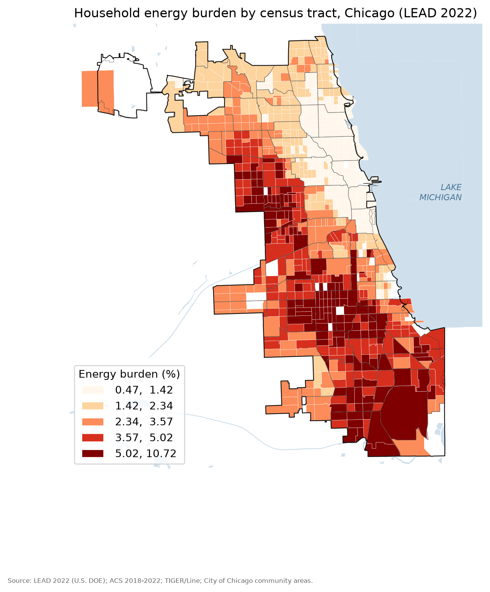 | 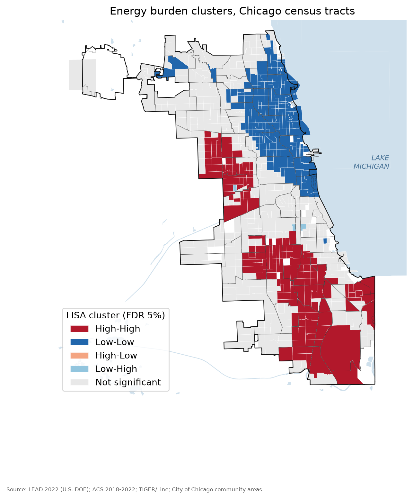 |

## 4. What explains it? (RQ2 and RQ3)

**Variance inflation factors**

|               |   VIF |
|:--------------|------:|
| ln_income     |  3.15 |
| pct_black     |  4.23 |
| pct_hispanic  |  3.01 |
| pct_pre1950   |  1.42 |
| pct_renter    |  2.49 |
| pct_multifam5 |  2.87 |

### Energy burden (%)

- n = 768; residual Moran's I (OLS) = 0.363 (p = 0.0000)
- LM lag = 228.54 (p = 0.0000); LM error = 305.22 (p = 0.0000); robust LM lag = 24.49 (p = 0.0000); robust LM error = 101.17 (p = 0.0000)
- Stage 1 (LM tests): Both robust LM tests reject; the larger statistic favors a spatial error model, and the spatial Durbin model is reported as a check.
- Stage 2 (LR tests): Both restrictions are rejected (common factor LR = 34.0, p = 0.0000; SDM vs lag LR = 57.7, p = 0.0000), so the spatial Durbin model is preferred.
- AIC: error 1631.8, lag 1657.6, Durbin 1611.8
- **Main model: durbin**

### ln(average energy cost)

- n = 768; residual Moran's I (OLS) = 0.277 (p = 0.0000)
- LM lag = 101.83 (p = 0.0000); LM error = 178.13 (p = 0.0000); robust LM lag = 14.54 (p = 0.0001); robust LM error = 90.84 (p = 0.0000)
- Stage 1 (LM tests): Both robust LM tests reject; the larger statistic favors a spatial error model, and the spatial Durbin model is reported as a check.
- Stage 2 (LR tests): Both restrictions are rejected (common factor LR = 59.1, p = 0.0000; SDM vs lag LR = 116.5, p = 0.0000), so the spatial Durbin model is preferred.
- AIC: error -1276.2, lag -1216.9, Durbin -1321.3
- **Main model: durbin**

### Electricity burden (%)

- n = 768; residual Moran's I (OLS) = 0.280 (p = 0.0000)
- LM lag = 129.32 (p = 0.0000); LM error = 181.90 (p = 0.0000); robust LM lag = 13.98 (p = 0.0002); robust LM error = 66.56 (p = 0.0000)
- Stage 1 (LM tests): Both robust LM tests reject; the larger statistic favors a spatial error model, and the spatial Durbin model is reported as a check.
- Stage 2 (LR tests): Both restrictions are rejected (common factor LR = 28.9, p = 0.0001; SDM vs lag LR = 51.0, p = 0.0000), so the spatial Durbin model is preferred.
- AIC: error 318.7, lag 342.8, Durbin 303.8
- **Main model: durbin**

### ln(average electricity cost)

- n = 768; residual Moran's I (OLS) = 0.213 (p = 0.0000)
- LM lag = 70.05 (p = 0.0000); LM error = 104.98 (p = 0.0000); robust LM lag = 6.11 (p = 0.0134); robust LM error = 41.04 (p = 0.0000)
- Stage 1 (LM tests): Both robust LM tests reject; the larger statistic favors a spatial error model, and the spatial Durbin model is reported as a check.
- Stage 2 (LR tests): Both restrictions are rejected (common factor LR = 32.0, p = 0.0000; SDM vs lag LR = 55.9, p = 0.0000), so the spatial Durbin model is preferred.
- AIC: error -1387.8, lag -1361.9, Durbin -1405.8
- **Main model: durbin**

### Gas burden (%)

- n = 768; residual Moran's I (OLS) = 0.378 (p = 0.0000)
- LM lag = 259.42 (p = 0.0000); LM error = 330.49 (p = 0.0000); robust LM lag = 25.41 (p = 0.0000); robust LM error = 96.48 (p = 0.0000)
- Stage 1 (LM tests): Both robust LM tests reject; the larger statistic favors a spatial error model, and the spatial Durbin model is reported as a check.
- Stage 2 (LR tests): Both restrictions are rejected (common factor LR = 35.3, p = 0.0000; SDM vs lag LR = 56.0, p = 0.0000), so the spatial Durbin model is preferred.
- AIC: error 913.8, lag 936.6, Durbin 892.6
- **Main model: durbin**

### ln(average gas cost)

- n = 768; residual Moran's I (OLS) = 0.326 (p = 0.0000)
- LM lag = 160.61 (p = 0.0000); LM error = 246.18 (p = 0.0000); robust LM lag = 22.89 (p = 0.0000); robust LM error = 108.47 (p = 0.0000)
- Stage 1 (LM tests): Both robust LM tests reject; the larger statistic favors a spatial error model, and the spatial Durbin model is reported as a check.
- Stage 2 (LR tests): Both restrictions are rejected (common factor LR = 55.5, p = 0.0000; SDM vs lag LR = 106.4, p = 0.0000), so the spatial Durbin model is preferred.
- AIC: error -592.5, lag -539.6, Durbin -634.1
- **Main model: durbin**

### Electricity burden (%), heating fuel control

- n = 768; residual Moran's I (OLS) = 0.255 (p = 0.0000)
- LM lag = 130.20 (p = 0.0000); LM error = 151.18 (p = 0.0000); robust LM lag = 23.27 (p = 0.0000); robust LM error = 44.25 (p = 0.0000)
- Stage 1 (LM tests): Both robust LM tests reject; the larger statistic favors a spatial error model, and the spatial Durbin model is reported as a check.
- Stage 2 (LR tests): Both restrictions are rejected (common factor LR = 39.2, p = 0.0000; SDM vs lag LR = 46.3, p = 0.0000), so the spatial Durbin model is preferred.
- AIC: error 315.7, lag 324.7, Durbin 292.4
- **Main model: durbin**

### Gas burden (%), heating fuel control

- n = 768; residual Moran's I (OLS) = 0.356 (p = 0.0000)
- LM lag = 260.85 (p = 0.0000); LM error = 294.25 (p = 0.0000); robust LM lag = 36.52 (p = 0.0000); robust LM error = 69.91 (p = 0.0000)
- Stage 1 (LM tests): Both robust LM tests reject; the larger statistic favors a spatial error model, and the spatial Durbin model is reported as a check.
- Stage 2 (LR tests): Both restrictions are rejected (common factor LR = 44.7, p = 0.0000; SDM vs lag LR = 64.1, p = 0.0000), so the spatial Durbin model is preferred.
- AIC: error 912.2, lag 933.6, Durbin 883.5
- **Main model: durbin**

**Choosing the main model** (likelihood ratio tests nesting the spatial error and lag models inside the spatial Durbin model)

| Outcome | LM tests chose | Common factor LR (p) | Durbin vs lag LR (p) | AIC error / lag / Durbin | Main model |
|---|---|---|---|---|---|
| burden_pct | error | 34.0 (0.0000) | 57.7 (0.0000) | 1631.8 / 1657.6 / 1611.8 | **durbin** |
| ln_avg_energy_cost | error | 59.1 (0.0000) | 116.5 (0.0000) | -1276.2 / -1216.9 / -1321.3 | **durbin** |
| elec_burden_pct | error | 28.9 (0.0001) | 51.0 (0.0000) | 318.7 / 342.8 / 303.8 | **durbin** |
| ln_avg_elec_cost | error | 32.0 (0.0000) | 55.9 (0.0000) | -1387.8 / -1361.9 / -1405.8 | **durbin** |
| gas_burden_pct | error | 35.3 (0.0000) | 56.0 (0.0000) | 913.8 / 936.6 / 892.6 | **durbin** |
| ln_avg_gas_cost | error | 55.5 (0.0000) | 106.4 (0.0000) | -592.5 / -539.6 / -634.1 | **durbin** |
| elec_burden_pct_heat | error | 39.2 (0.0000) | 46.3 (0.0000) | 315.7 / 324.7 / 292.4 | **durbin** |
| gas_burden_pct_heat | error | 44.7 (0.0000) | 64.1 (0.0000) | 912.2 / 933.6 / 883.5 | **durbin** |

### Effects from the main models

Estimate with 95% interval; * p<0.05, ** p<0.01, *** p<0.001. For a spatial Durbin or lag model, direct = effect of a tract's own characteristics, indirect = spillover from neighbors, total = both. For a spatial error model, the coefficients are the effects.

**Energy burden (%)** (durbin model)

| label                        | direct                        | indirect                     | total                         |
|:-----------------------------|:------------------------------|:-----------------------------|:------------------------------|
| ln(median household income)  | -1.7521*** [-1.9413, -1.5579] | -0.4637 [-1.0296, 0.0924]    | -2.2158*** [-2.8142, -1.6350] |
| % Black                      | 0.0065* [0.0015, 0.0115]      | 0.0050 [-0.0053, 0.0150]     | 0.0115* [0.0019, 0.0209]      |
| % Hispanic                   | 0.0046 [-0.0010, 0.0103]      | -0.0043 [-0.0160, 0.0073]    | 0.0003 [-0.0104, 0.0110]      |
| % housing built before 1950  | 0.0052** [0.0017, 0.0087]     | -0.0133* [-0.0239, -0.0030]  | -0.0081 [-0.0194, 0.0025]     |
| % renter-occupied            | 0.0010 [-0.0032, 0.0056]      | 0.0073 [-0.0064, 0.0220]     | 0.0083 [-0.0061, 0.0239]      |
| % units in 5+ unit buildings | -0.0192*** [-0.0231, -0.0150] | -0.0151** [-0.0268, -0.0038] | -0.0343*** [-0.0455, -0.0236] |

**ln(average energy cost)** (durbin model)

| label                        | direct                        | indirect                      | total                         |
|:-----------------------------|:------------------------------|:------------------------------|:------------------------------|
| ln(median household income)  | 0.1189*** [0.0908, 0.1473]    | 0.0396 [-0.0372, 0.1140]      | 0.1585*** [0.0792, 0.2412]    |
| % Black                      | 0.0014*** [0.0007, 0.0022]    | 0.0021** [0.0007, 0.0034]     | 0.0035*** [0.0023, 0.0047]    |
| % Hispanic                   | 0.0013** [0.0005, 0.0022]     | 0.0002 [-0.0013, 0.0018]      | 0.0016* [0.0003, 0.0030]      |
| % housing built before 1950  | 0.0011*** [0.0006, 0.0016]    | -0.0017* [-0.0031, -0.0004]   | -0.0006 [-0.0021, 0.0008]     |
| % renter-occupied            | -0.0014*** [-0.0021, -0.0008] | 0.0032** [0.0014, 0.0052]     | 0.0018 [-0.0000, 0.0038]      |
| % units in 5+ unit buildings | -0.0073*** [-0.0079, -0.0067] | -0.0037*** [-0.0052, -0.0022] | -0.0110*** [-0.0124, -0.0096] |

**Electricity burden (%)** (durbin model)

| label                        | direct                        | indirect                      | total                         |
|:-----------------------------|:------------------------------|:------------------------------|:------------------------------|
| ln(median household income)  | -0.8305*** [-0.9116, -0.7468] | -0.1054 [-0.3003, 0.0845]     | -0.9359*** [-1.1358, -0.7358] |
| % Black                      | 0.0032** [0.0011, 0.0053]     | 0.0015 [-0.0023, 0.0052]      | 0.0047** [0.0014, 0.0079]     |
| % Hispanic                   | 0.0016 [-0.0009, 0.0041]      | -0.0020 [-0.0062, 0.0023]     | -0.0004 [-0.0040, 0.0032]     |
| % housing built before 1950  | 0.0009 [-0.0006, 0.0024]      | -0.0051** [-0.0088, -0.0015]  | -0.0042* [-0.0080, -0.0006]   |
| % renter-occupied            | 0.0002 [-0.0016, 0.0022]      | 0.0028 [-0.0020, 0.0078]      | 0.0030 [-0.0019, 0.0082]      |
| % units in 5+ unit buildings | -0.0048*** [-0.0066, -0.0030] | -0.0068*** [-0.0108, -0.0029] | -0.0117*** [-0.0154, -0.0081] |

**ln(average electricity cost)** (durbin model)

| label                        | direct                        | indirect                      | total                         |
|:-----------------------------|:------------------------------|:------------------------------|:------------------------------|
| ln(median household income)  | 0.0854*** [0.0586, 0.1127]    | 0.0519 [-0.0082, 0.1109]      | 0.1374*** [0.0775, 0.1983]    |
| % Black                      | 0.0014*** [0.0007, 0.0020]    | 0.0014* [0.0003, 0.0026]      | 0.0028*** [0.0019, 0.0037]    |
| % Hispanic                   | 0.0010* [0.0002, 0.0018]      | 0.0000 [-0.0012, 0.0013]      | 0.0011* [0.0001, 0.0021]      |
| % housing built before 1950  | -0.0001 [-0.0005, 0.0004]     | -0.0017** [-0.0027, -0.0006]  | -0.0017*** [-0.0029, -0.0007] |
| % renter-occupied            | -0.0021*** [-0.0027, -0.0015] | 0.0020** [0.0005, 0.0035]     | -0.0001 [-0.0015, 0.0014]     |
| % units in 5+ unit buildings | -0.0042*** [-0.0048, -0.0036] | -0.0021*** [-0.0033, -0.0009] | -0.0063*** [-0.0074, -0.0053] |

**Gas burden (%)** (durbin model)

| label                        | direct                        | indirect                    | total                         |
|:-----------------------------|:------------------------------|:----------------------------|:------------------------------|
| ln(median household income)  | -0.9063*** [-1.0254, -0.7845] | -0.3573 [-0.7365, 0.0106]   | -1.2636*** [-1.6610, -0.8720] |
| % Black                      | 0.0033* [0.0002, 0.0064]      | 0.0036 [-0.0032, 0.0102]    | 0.0069* [0.0004, 0.0132]      |
| % Hispanic                   | 0.0031 [-0.0004, 0.0066]      | -0.0020 [-0.0098, 0.0055]   | 0.0010 [-0.0061, 0.0083]      |
| % housing built before 1950  | 0.0042*** [0.0020, 0.0064]    | -0.0080* [-0.0151, -0.0011] | -0.0038 [-0.0113, 0.0033]     |
| % renter-occupied            | 0.0009 [-0.0017, 0.0038]      | 0.0043 [-0.0048, 0.0141]    | 0.0052 [-0.0042, 0.0157]      |
| % units in 5+ unit buildings | -0.0142*** [-0.0167, -0.0116] | -0.0081* [-0.0158, -0.0005] | -0.0223*** [-0.0299, -0.0152] |

**ln(average gas cost)** (durbin model)

| label                        | direct                        | indirect                      | total                         |
|:-----------------------------|:------------------------------|:------------------------------|:------------------------------|
| ln(median household income)  | 0.1614*** [0.1182, 0.2068]    | 0.0834 [-0.0502, 0.2223]      | 0.2447*** [0.1053, 0.3888]    |
| % Black                      | 0.0017** [0.0005, 0.0028]     | 0.0028* [0.0005, 0.0052]      | 0.0045*** [0.0024, 0.0067]    |
| % Hispanic                   | 0.0018** [0.0005, 0.0031]     | 0.0002 [-0.0025, 0.0029]      | 0.0020 [-0.0003, 0.0045]      |
| % housing built before 1950  | 0.0026*** [0.0017, 0.0034]    | -0.0022 [-0.0046, 0.0002]     | 0.0004 [-0.0022, 0.0029]      |
| % renter-occupied            | -0.0004 [-0.0015, 0.0006]     | 0.0060*** [0.0028, 0.0095]    | 0.0056*** [0.0022, 0.0093]    |
| % units in 5+ unit buildings | -0.0107*** [-0.0116, -0.0097] | -0.0068*** [-0.0094, -0.0042] | -0.0174*** [-0.0200, -0.0150] |

**Electricity burden (%), heating fuel control** (durbin model)

| label                        | direct                        | indirect                      | total                         |
|:-----------------------------|:------------------------------|:------------------------------|:------------------------------|
| ln(median household income)  | -0.8138*** [-0.8929, -0.7296] | -0.1325 [-0.3125, 0.0593]     | -0.9463*** [-1.1348, -0.7443] |
| % Black                      | 0.0031** [0.0009, 0.0052]     | 0.0012 [-0.0023, 0.0049]      | 0.0043** [0.0013, 0.0074]     |
| % Hispanic                   | 0.0016 [-0.0009, 0.0039]      | -0.0022 [-0.0062, 0.0020]     | -0.0006 [-0.0037, 0.0026]     |
| % housing built before 1950  | 0.0015 [-0.0000, 0.0030]      | -0.0033 [-0.0071, 0.0004]     | -0.0019 [-0.0055, 0.0018]     |
| % renter-occupied            | 0.0003 [-0.0015, 0.0022]      | 0.0024 [-0.0024, 0.0068]      | 0.0027 [-0.0020, 0.0074]      |
| % units in 5+ unit buildings | -0.0057*** [-0.0075, -0.0038] | -0.0099*** [-0.0144, -0.0058] | -0.0156*** [-0.0199, -0.0116] |
| pct_elec_heat                | 0.0043** [0.0016, 0.0072]     | 0.0085* [0.0013, 0.0157]      | 0.0129** [0.0054, 0.0205]     |

**Gas burden (%), heating fuel control** (durbin model)

| label                        | direct                        | indirect                      | total                         |
|:-----------------------------|:------------------------------|:------------------------------|:------------------------------|
| ln(median household income)  | -0.9375*** [-1.0567, -0.8134] | -0.3605 [-0.7062, 0.0200]     | -1.2980*** [-1.6670, -0.9046] |
| % Black                      | 0.0032* [0.0000, 0.0063]      | 0.0030 [-0.0031, 0.0097]      | 0.0062* [0.0003, 0.0120]      |
| % Hispanic                   | 0.0028 [-0.0008, 0.0062]      | -0.0023 [-0.0095, 0.0051]     | 0.0006 [-0.0057, 0.0070]      |
| % housing built before 1950  | 0.0044*** [0.0023, 0.0068]    | -0.0034 [-0.0105, 0.0036]     | 0.0010 [-0.0061, 0.0082]      |
| % renter-occupied            | 0.0009 [-0.0019, 0.0036]      | 0.0027 [-0.0064, 0.0114]      | 0.0035 [-0.0058, 0.0129]      |
| % units in 5+ unit buildings | -0.0142*** [-0.0167, -0.0114] | -0.0146*** [-0.0231, -0.0070] | -0.0287*** [-0.0373, -0.0209] |
| pct_elec_heat                | -0.0013 [-0.0053, 0.0030]     | 0.0249*** [0.0112, 0.0393]    | 0.0236** [0.0091, 0.0391]     |

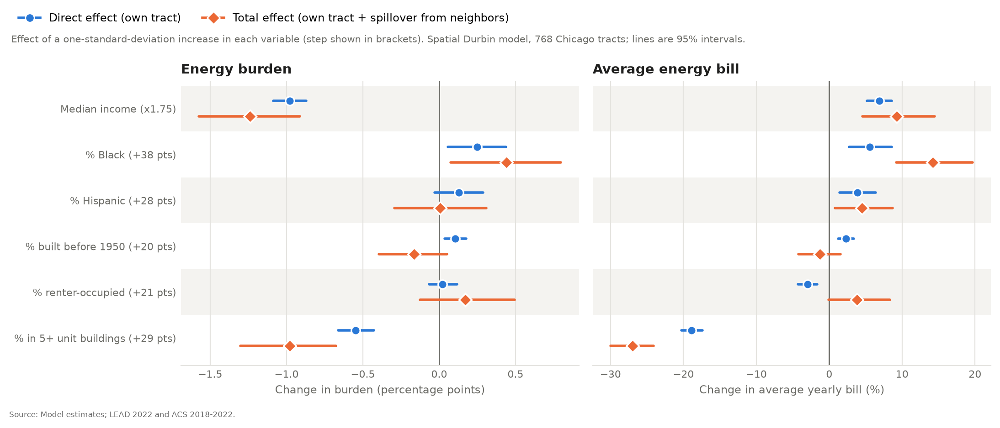

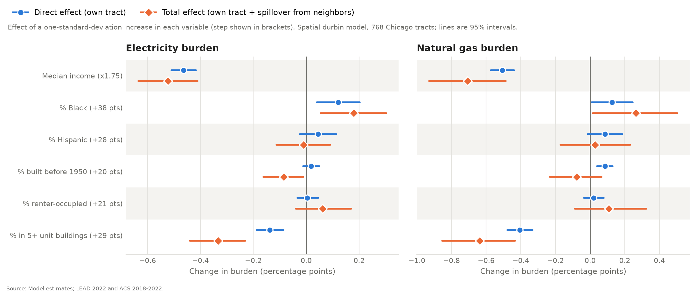

### All coefficients

Coefficient (standard error); * p<0.05, ** p<0.01, *** p<0.001.

**burden_pct**

| label                                   | OLS               | Error             | Lag               | Durbin            |
|:----------------------------------------|:------------------|:------------------|:------------------|:------------------|
| Constant                                | 25.087*** (1.135) | 23.203*** (1.147) | 17.978*** (1.126) | 10.872*** (1.741) |
| ln(median household income)             | -1.957*** (0.092) | -1.811*** (0.093) | -1.435*** (0.090) | -1.724*** (0.096) |
| % Black                                 | 0.016*** (0.002)  | 0.013*** (0.002)  | 0.003* (0.002)    | 0.006* (0.003)    |
| % Hispanic                              | 0.005** (0.002)   | 0.007** (0.002)   | -0.002 (0.002)    | 0.005 (0.003)     |
| % housing built before 1950             | 0.002 (0.002)     | 0.006** (0.002)   | 0.001 (0.001)     | 0.006*** (0.002)  |
| % renter-occupied                       | 0.001 (0.002)     | -0.001 (0.002)    | 0.002 (0.002)     | 0.001 (0.002)     |
| % units in 5+ unit buildings            | -0.027*** (0.002) | -0.021*** (0.002) | -0.017*** (0.002) | -0.018*** (0.002) |
| lambda (spatial error)                  |                   | 0.671*** (0.035)  |                   |                   |
| rho (spatial lag)                       |                   |                   | 0.467*** (0.032)  | 0.619*** (0.038)  |
| Neighbors' ln(median household income)  |                   |                   |                   | 0.880*** (0.159)  |
| Neighbors' % Black                      |                   |                   |                   | -0.002 (0.003)    |
| Neighbors' % Hispanic                   |                   |                   |                   | -0.005 (0.004)    |
| Neighbors' % housing built before 1950  |                   |                   |                   | -0.009*** (0.003) |
| Neighbors' % renter-occupied            |                   |                   |                   | 0.003 (0.003)     |
| Neighbors' % units in 5+ unit buildings |                   |                   |                   | 0.005 (0.003)     |

**ln_avg_energy_cost**

| label                                   | OLS               | Error             | Lag               | Durbin            |
|:----------------------------------------|:------------------|:------------------|:------------------|:------------------|
| Constant                                | 6.759*** (0.163)  | 6.841*** (0.172)  | 4.328*** (0.278)  | 2.695*** (0.334)  |
| ln(median household income)             | 0.107*** (0.013)  | 0.100*** (0.014)  | 0.120*** (0.012)  | 0.117*** (0.014)  |
| % Black                                 | 0.003*** (0.000)  | 0.003*** (0.000)  | 0.003*** (0.000)  | 0.001** (0.000)   |
| % Hispanic                              | 0.002*** (0.000)  | 0.002*** (0.000)  | 0.001*** (0.000)  | 0.001** (0.000)   |
| % housing built before 1950             | 0.001*** (0.000)  | 0.001*** (0.000)  | 0.001*** (0.000)  | 0.001*** (0.000)  |
| % renter-occupied                       | -0.001** (0.000)  | -0.002*** (0.000) | -0.001* (0.000)   | -0.002*** (0.000) |
| % units in 5+ unit buildings            | -0.009*** (0.000) | -0.008*** (0.000) | -0.007*** (0.000) | -0.007*** (0.000) |
| lambda (spatial error)                  |                   | 0.638*** (0.037)  |                   |                   |
| rho (spatial lag)                       |                   |                   | 0.286*** (0.028)  | 0.564*** (0.041)  |
| Neighbors' ln(median household income)  |                   |                   |                   | -0.047* (0.022)   |
| Neighbors' % Black                      |                   |                   |                   | 0.000 (0.001)     |
| Neighbors' % Hispanic                   |                   |                   |                   | -0.001 (0.001)    |
| Neighbors' % housing built before 1950  |                   |                   |                   | -0.001*** (0.000) |
| Neighbors' % renter-occupied            |                   |                   |                   | 0.002*** (0.001)  |
| Neighbors' % units in 5+ unit buildings |                   |                   |                   | 0.002*** (0.001)  |

**elec_burden_pct**

| label                                   | OLS               | Error             | Lag               | Durbin            |
|:----------------------------------------|:------------------|:------------------|:------------------|:------------------|
| Constant                                | 11.489*** (0.456) | 11.011*** (0.483) | 9.225*** (0.482)  | 5.866*** (0.797)  |
| ln(median household income)             | -0.899*** (0.037) | -0.867*** (0.039) | -0.735*** (0.039) | -0.824*** (0.042) |
| % Black                                 | 0.006*** (0.001)  | 0.006*** (0.001)  | 0.002** (0.001)   | 0.003** (0.001)   |
| % Hispanic                              | 0.001 (0.001)     | 0.002* (0.001)    | -0.001 (0.001)    | 0.002 (0.001)     |
| % housing built before 1950             | -0.001 (0.001)    | 0.001 (0.001)     | -0.001 (0.001)    | 0.001 (0.001)     |
| % renter-occupied                       | 0.000 (0.001)     | -0.001 (0.001)    | 0.001 (0.001)     | 0.000 (0.001)     |
| % units in 5+ unit buildings            | -0.009*** (0.001) | -0.006*** (0.001) | -0.006*** (0.001) | -0.004*** (0.001) |
| lambda (spatial error)                  |                   | 0.557*** (0.042)  |                   |                   |
| rho (spatial lag)                       |                   |                   | 0.360*** (0.033)  | 0.515*** (0.044)  |
| Neighbors' ln(median household income)  |                   |                   |                   | 0.371*** (0.072)  |
| Neighbors' % Black                      |                   |                   |                   | -0.001 (0.001)    |
| Neighbors' % Hispanic                   |                   |                   |                   | -0.002 (0.002)    |
| Neighbors' % housing built before 1950  |                   |                   |                   | -0.003** (0.001)  |
| Neighbors' % renter-occupied            |                   |                   |                   | 0.001 (0.001)     |
| Neighbors' % units in 5+ unit buildings |                   |                   |                   | -0.001 (0.001)    |

**ln_avg_elec_cost**

| label                                   | OLS               | Error             | Lag               | Durbin            |
|:----------------------------------------|:------------------|:------------------|:------------------|:------------------|
| Constant                                | 6.134*** (0.146)  | 6.304*** (0.158)  | 4.049*** (0.287)  | 3.103*** (0.338)  |
| ln(median household income)             | 0.095*** (0.012)  | 0.080*** (0.013)  | 0.096*** (0.011)  | 0.083*** (0.014)  |
| % Black                                 | 0.003*** (0.000)  | 0.002*** (0.000)  | 0.002*** (0.000)  | 0.001*** (0.000)  |
| % Hispanic                              | 0.001*** (0.000)  | 0.001*** (0.000)  | 0.001*** (0.000)  | 0.001* (0.000)    |
| % housing built before 1950             | -0.001* (0.000)   | -0.000 (0.000)    | -0.000 (0.000)    | 0.000 (0.000)     |
| % renter-occupied                       | -0.002*** (0.000) | -0.002*** (0.000) | -0.001*** (0.000) | -0.002*** (0.000) |
| % units in 5+ unit buildings            | -0.005*** (0.000) | -0.005*** (0.000) | -0.004*** (0.000) | -0.004*** (0.000) |
| lambda (spatial error)                  |                   | 0.493*** (0.045)  |                   |                   |
| rho (spatial lag)                       |                   |                   | 0.289*** (0.035)  | 0.453*** (0.047)  |
| Neighbors' ln(median household income)  |                   |                   |                   | -0.007 (0.021)    |
| Neighbors' % Black                      |                   |                   |                   | 0.000 (0.000)     |
| Neighbors' % Hispanic                   |                   |                   |                   | -0.000 (0.001)    |
| Neighbors' % housing built before 1950  |                   |                   |                   | -0.001** (0.000)  |
| Neighbors' % renter-occupied            |                   |                   |                   | 0.002*** (0.000)  |
| Neighbors' % units in 5+ unit buildings |                   |                   |                   | 0.001 (0.001)     |

**gas_burden_pct**

| label                                   | OLS               | Error             | Lag               | Durbin            |
|:----------------------------------------|:------------------|:------------------|:------------------|:------------------|
| Constant                                | 13.410*** (0.722) | 12.090*** (0.719) | 8.891*** (0.690)  | 5.768*** (1.035)  |
| ln(median household income)             | -1.043*** (0.059) | -0.934*** (0.058) | -0.708*** (0.055) | -0.884*** (0.060) |
| % Black                                 | 0.010*** (0.001)  | 0.008*** (0.001)  | 0.002* (0.001)    | 0.003 (0.002)     |
| % Hispanic                              | 0.004*** (0.001)  | 0.005** (0.002)   | -0.001 (0.001)    | 0.003 (0.002)     |
| % housing built before 1950             | 0.002* (0.001)    | 0.005*** (0.001)  | 0.001 (0.001)     | 0.005*** (0.001)  |
| % renter-occupied                       | 0.001 (0.001)     | -0.000 (0.001)    | 0.002 (0.001)     | 0.001 (0.001)     |
| % units in 5+ unit buildings            | -0.018*** (0.001) | -0.015*** (0.001) | -0.011*** (0.001) | -0.014*** (0.001) |
| lambda (spatial error)                  |                   | 0.701*** (0.033)  |                   |                   |
| rho (spatial lag)                       |                   |                   | 0.511*** (0.032)  | 0.645*** (0.036)  |
| Neighbors' ln(median household income)  |                   |                   |                   | 0.435*** (0.096)  |
| Neighbors' % Black                      |                   |                   |                   | -0.001 (0.002)    |
| Neighbors' % Hispanic                   |                   |                   |                   | -0.003 (0.002)    |
| Neighbors' % housing built before 1950  |                   |                   |                   | -0.006*** (0.002) |
| Neighbors' % renter-occupied            |                   |                   |                   | 0.001 (0.002)     |
| Neighbors' % units in 5+ unit buildings |                   |                   |                   | 0.006** (0.002)   |

**ln_avg_gas_cost**

| label                                   | OLS               | Error             | Lag               | Durbin            |
|:----------------------------------------|:------------------|:------------------|:------------------|:------------------|
| Constant                                | 5.797*** (0.263)  | 5.833*** (0.270)  | 2.730*** (0.324)  | 1.706*** (0.374)  |
| ln(median household income)             | 0.132*** (0.021)  | 0.129*** (0.022)  | 0.164*** (0.019)  | 0.156*** (0.022)  |
| % Black                                 | 0.004*** (0.000)  | 0.003*** (0.000)  | 0.003*** (0.000)  | 0.001* (0.001)    |
| % Hispanic                              | 0.002*** (0.000)  | 0.003*** (0.001)  | 0.001*** (0.000)  | 0.002** (0.001)   |
| % housing built before 1950             | 0.003*** (0.000)  | 0.003*** (0.000)  | 0.002*** (0.000)  | 0.003*** (0.000)  |
| % renter-occupied                       | 0.000 (0.001)     | -0.001* (0.001)   | 0.001 (0.000)     | -0.001 (0.001)    |
| % units in 5+ unit buildings            | -0.013*** (0.000) | -0.011*** (0.000) | -0.010*** (0.000) | -0.010*** (0.001) |
| lambda (spatial error)                  |                   | 0.683*** (0.034)  |                   |                   |
| rho (spatial lag)                       |                   |                   | 0.369*** (0.028)  | 0.621*** (0.038)  |
| Neighbors' ln(median household income)  |                   |                   |                   | -0.063 (0.033)    |
| Neighbors' % Black                      |                   |                   |                   | 0.000 (0.001)     |
| Neighbors' % Hispanic                   |                   |                   |                   | -0.001 (0.001)    |
| Neighbors' % housing built before 1950  |                   |                   |                   | -0.003*** (0.001) |
| Neighbors' % renter-occupied            |                   |                   |                   | 0.003*** (0.001)  |
| Neighbors' % units in 5+ unit buildings |                   |                   |                   | 0.004*** (0.001)  |

**elec_burden_pct_heat**

| label                                   | OLS               | Error             | Lag               | Durbin            |
|:----------------------------------------|:------------------|:------------------|:------------------|:------------------|
| Constant                                | 11.297*** (0.453) | 10.831*** (0.489) | 9.057*** (0.475)  | 6.277*** (0.802)  |
| ln(median household income)             | -0.888*** (0.037) | -0.855*** (0.039) | -0.725*** (0.038) | -0.806*** (0.042) |
| % Black                                 | 0.006*** (0.001)  | 0.006*** (0.001)  | 0.002** (0.001)   | 0.003** (0.001)   |
| % Hispanic                              | 0.002* (0.001)    | 0.002* (0.001)    | -0.000 (0.001)    | 0.002 (0.001)     |
| % housing built before 1950             | 0.000 (0.001)     | 0.001 (0.001)     | -0.000 (0.001)    | 0.002* (0.001)    |
| % renter-occupied                       | 0.000 (0.001)     | -0.001 (0.001)    | 0.001 (0.001)     | 0.000 (0.001)     |
| % units in 5+ unit buildings            | -0.010*** (0.001) | -0.007*** (0.001) | -0.008*** (0.001) | -0.005*** (0.001) |
| pct_elec_heat                           | 0.006*** (0.001)  | 0.003* (0.001)    | 0.006*** (0.001)  | 0.004** (0.001)   |
| lambda (spatial error)                  |                   | 0.547*** (0.042)  |                   |                   |
| rho (spatial lag)                       |                   |                   | 0.358*** (0.033)  | 0.481*** (0.045)  |
| Neighbors' ln(median household income)  |                   |                   |                   | 0.315*** (0.073)  |
| Neighbors' % Black                      |                   |                   |                   | -0.001 (0.001)    |
| Neighbors' % Hispanic                   |                   |                   |                   | -0.002 (0.002)    |
| Neighbors' % housing built before 1950  |                   |                   |                   | -0.003* (0.001)   |
| Neighbors' % renter-occupied            |                   |                   |                   | 0.001 (0.001)     |
| Neighbors' % units in 5+ unit buildings |                   |                   |                   | -0.003 (0.002)    |
| W_pct_elec_heat                         |                   |                   |                   | 0.003 (0.002)     |

**gas_burden_pct_heat**

| label                                   | OLS               | Error             | Lag               | Durbin            |
|:----------------------------------------|:------------------|:------------------|:------------------|:------------------|
| Constant                                | 13.241*** (0.723) | 12.353*** (0.732) | 8.776*** (0.692)  | 6.271*** (1.042)  |
| ln(median household income)             | -1.033*** (0.059) | -0.952*** (0.059) | -0.702*** (0.055) | -0.915*** (0.061) |
| % Black                                 | 0.010*** (0.001)  | 0.008*** (0.001)  | 0.002* (0.001)    | 0.003 (0.002)     |
| % Hispanic                              | 0.004*** (0.001)  | 0.005** (0.002)   | -0.000 (0.001)    | 0.003 (0.002)     |
| % housing built before 1950             | 0.003** (0.001)   | 0.004*** (0.001)  | 0.002* (0.001)    | 0.005*** (0.001)  |
| % renter-occupied                       | 0.001 (0.001)     | -0.000 (0.001)    | 0.002 (0.001)     | 0.001 (0.001)     |
| % units in 5+ unit buildings            | -0.020*** (0.001) | -0.014*** (0.001) | -0.012*** (0.001) | -0.013*** (0.001) |
| pct_elec_heat                           | 0.005* (0.002)    | -0.004 (0.002)    | 0.004* (0.002)    | -0.003 (0.002)    |
| lambda (spatial error)                  |                   | 0.708*** (0.033)  |                   |                   |
| rho (spatial lag)                       |                   |                   | 0.509*** (0.032)  | 0.618*** (0.038)  |
| Neighbors' ln(median household income)  |                   |                   |                   | 0.419*** (0.097)  |
| Neighbors' % Black                      |                   |                   |                   | -0.001 (0.002)    |
| Neighbors' % Hispanic                   |                   |                   |                   | -0.003 (0.002)    |
| Neighbors' % housing built before 1950  |                   |                   |                   | -0.004* (0.002)   |
| Neighbors' % renter-occupied            |                   |                   |                   | 0.001 (0.002)     |
| Neighbors' % units in 5+ unit buildings |                   |                   |                   | 0.002 (0.002)     |
| W_pct_elec_heat                         |                   |                   |                   | 0.012*** (0.003)  |

**Model comparison**

| spec                 | outcome            | model   |       aic |    logll |   moran_resid_I |   n |
|:---------------------|:-------------------|:--------|----------:|---------:|----------------:|----:|
| burden_pct           | burden_pct         | OLS     |  1855.02  | -920.512 |           0.363 | 768 |
| burden_pct           | burden_pct         | error   |  1631.77  | -808.886 |          -0.036 | 768 |
| burden_pct           | burden_pct         | lag     |  1657.56  | -820.78  |           0.072 | 768 |
| burden_pct           | burden_pct         | durbin  |  1611.81  | -791.906 |          -0.03  | 768 |
| ln_avg_energy_cost   | ln_avg_energy_cost | OLS     | -1122.3   |  568.15  |           0.277 | 768 |
| ln_avg_energy_cost   | ln_avg_energy_cost | error   | -1276.24  |  645.12  |          -0.019 | 768 |
| ln_avg_energy_cost   | ln_avg_energy_cost | lag     | -1216.89  |  616.444 |           0.134 | 768 |
| ln_avg_energy_cost   | ln_avg_energy_cost | durbin  | -1321.34  |  674.67  |          -0.009 | 768 |
| elec_burden_pct      | elec_burden_pct    | OLS     |   453.753 | -219.877 |           0.28  | 768 |
| elec_burden_pct      | elec_burden_pct    | error   |   318.709 | -152.355 |          -0.027 | 768 |
| elec_burden_pct      | elec_burden_pct    | lag     |   342.776 | -163.388 |           0.073 | 768 |
| elec_burden_pct      | elec_burden_pct    | durbin  |   303.786 | -137.893 |          -0.026 | 768 |
| ln_avg_elec_cost     | ln_avg_elec_cost   | OLS     | -1299.52  |  656.76  |           0.213 | 768 |
| ln_avg_elec_cost     | ln_avg_elec_cost   | error   | -1387.81  |  700.907 |          -0.011 | 768 |
| ln_avg_elec_cost     | ln_avg_elec_cost   | lag     | -1361.95  |  688.974 |           0.078 | 768 |
| ln_avg_elec_cost     | ln_avg_elec_cost   | durbin  | -1405.81  |  716.904 |          -0.006 | 768 |
| gas_burden_pct       | gas_burden_pct     | OLS     |  1159.98  | -572.99  |           0.378 | 768 |
| gas_burden_pct       | gas_burden_pct     | error   |   913.84  | -449.92  |          -0.032 | 768 |
| gas_burden_pct       | gas_burden_pct     | lag     |   936.595 | -460.297 |           0.062 | 768 |
| gas_burden_pct       | gas_burden_pct     | durbin  |   892.558 | -432.279 |          -0.024 | 768 |
| ln_avg_gas_cost      | ln_avg_gas_cost    | OLS     |  -392.186 |  203.093 |           0.326 | 768 |
| ln_avg_gas_cost      | ln_avg_gas_cost    | error   |  -592.534 |  303.267 |          -0.038 | 768 |
| ln_avg_gas_cost      | ln_avg_gas_cost    | lag     |  -539.629 |  277.815 |           0.116 | 768 |
| ln_avg_gas_cost      | ln_avg_gas_cost    | durbin  |  -634.071 |  331.035 |          -0.028 | 768 |
| elec_burden_pct_heat | elec_burden_pct    | OLS     |   436.793 | -210.396 |           0.255 | 768 |
| elec_burden_pct_heat | elec_burden_pct    | error   |   315.672 | -149.836 |          -0.026 | 768 |
| elec_burden_pct_heat | elec_burden_pct    | lag     |   324.732 | -153.366 |           0.055 | 768 |
| elec_burden_pct_heat | elec_burden_pct    | durbin  |   292.443 | -130.221 |          -0.024 | 768 |
| gas_burden_pct_heat  | gas_burden_pct     | OLS     |  1156.13  | -570.067 |           0.356 | 768 |
| gas_burden_pct_heat  | gas_burden_pct     | error   |   912.153 | -448.077 |          -0.034 | 768 |
| gas_burden_pct_heat  | gas_burden_pct     | lag     |   933.563 | -457.782 |           0.049 | 768 |
| gas_burden_pct_heat  | gas_burden_pct     | durbin  |   883.472 | -425.736 |          -0.024 | 768 |

## 5. Does it differ across the city? (RQ4)

MGWR adjusted R² = 0.930; AICc = 338.8; max local condition number = 9.3

| Variable | Bandwidth (neighbors) |
|---|---|
| CONSTANT | 433 |
| ln_income | 18 |
| pct_black | 205 |
| pct_hispanic | 98 |
| pct_pre1950 | 210 |
| pct_renter | 760 |
| pct_multifam5 | 157 |

**Model comparison, energy burden** (all on the original scale; lower AIC is better)

| model          |     aic |    logll |   moran_resid_I |   pseudo_r2 |   effective_parameters |   delta_aic |
|:---------------|--------:|---------:|----------------:|------------:|-----------------------:|------------:|
| OLS            | 1855.02 | -920.512 |           0.363 |             |                        |     542.248 |
| Spatial error  | 1631.77 | -808.886 |          -0.036 |             |                        |     318.994 |
| Spatial lag    | 1657.56 | -820.78  |           0.072 |             |                        |     344.783 |
| Spatial Durbin | 1611.81 | -791.906 |          -0.03  |             |                        |     299.035 |
| MGWR           | 1312.78 | -509.638 |          -0.027 |       0.943 |                 145.75 |       0     |

|   |   |   |
|---|---|---|
| 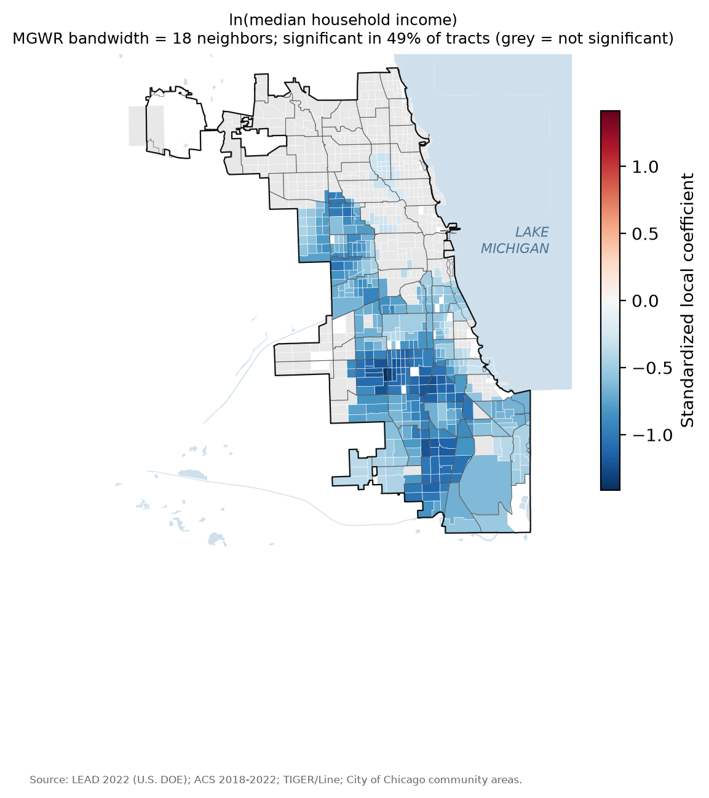 | 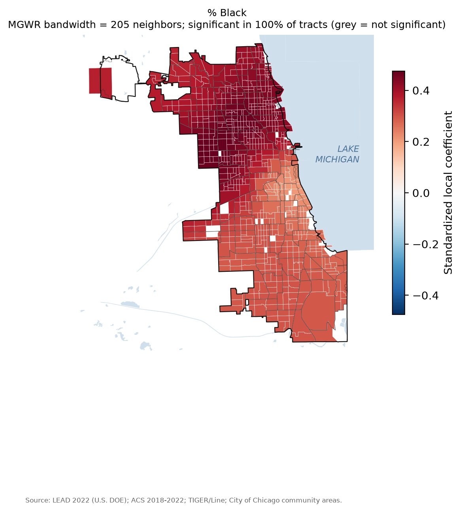 | 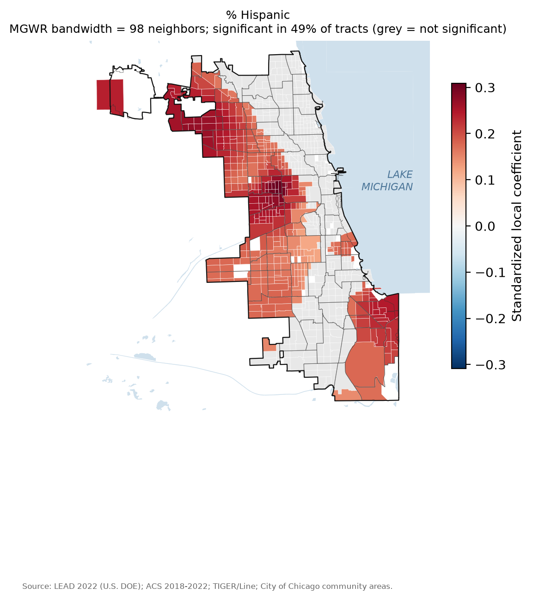 |

|   |   |   |
|---|---|---|
| 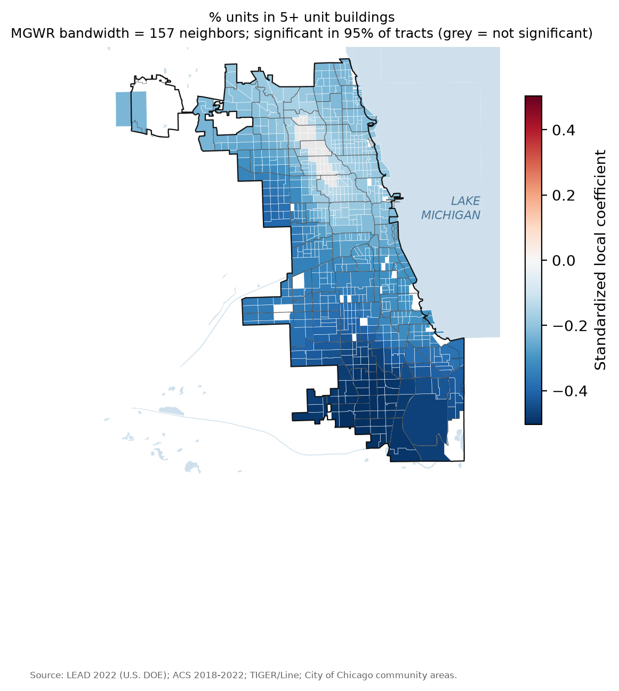 | 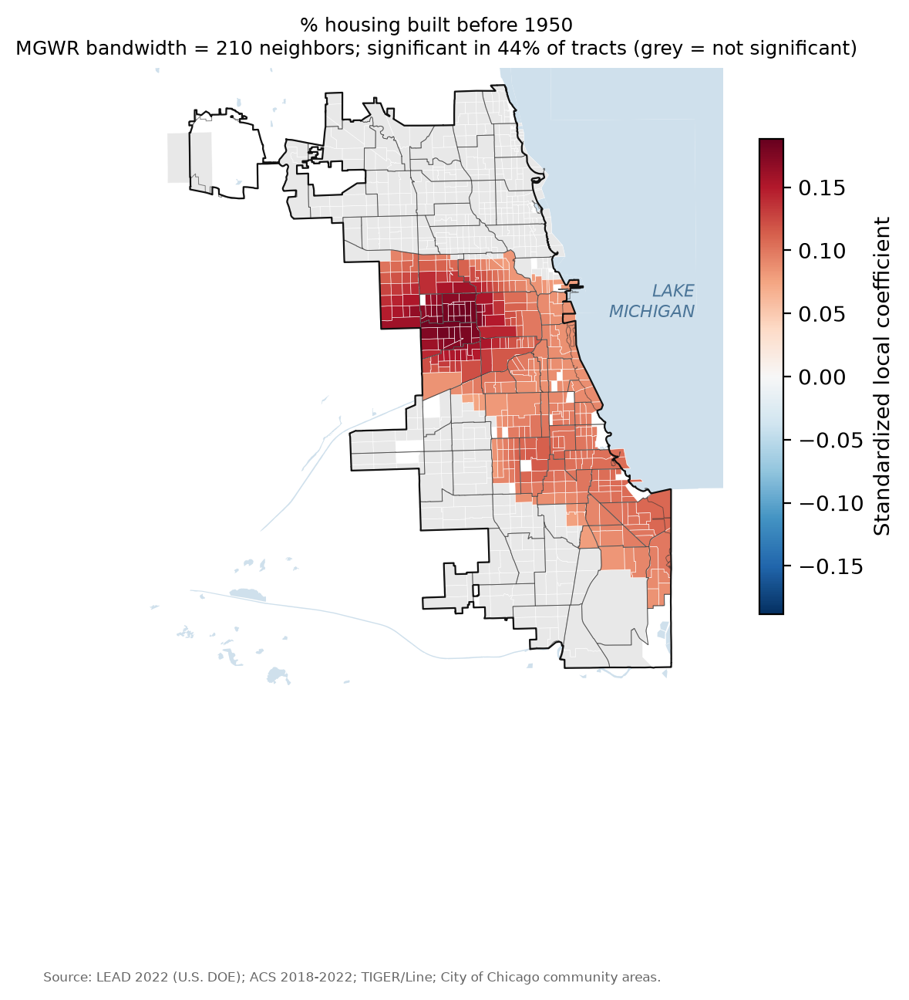 | 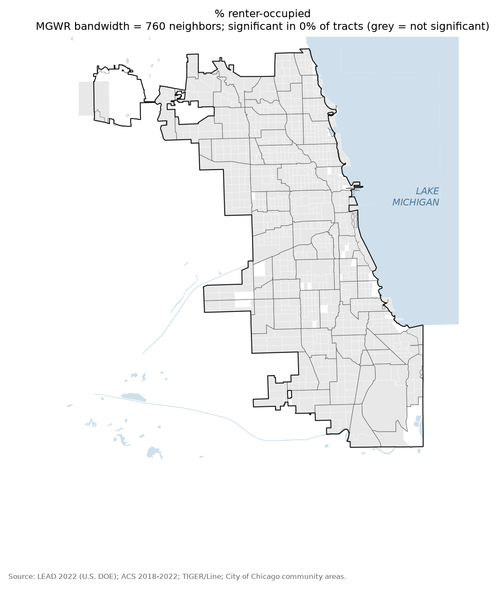 |

## 6. Robustness checks

Each column changes one thing relative to the main spatial error model. Coefficient (standard error); * p<0.05, ** p<0.01, *** p<0.001.

- Energy burden (%), direct effects (durbin model): 3 of 6 keep the same sign and significance in every specification.
- Energy burden (%), total effects (durbin model): 3 of 6 keep the same sign and significance in every specification.
- ln(average energy cost), direct effects (durbin model): 5 of 6 keep the same sign and significance in every specification.
- ln(average energy cost), total effects (durbin model): 5 of 6 keep the same sign and significance in every specification.

**Energy burden (%)**

|                              | Main (queen, ACS 2018-22)   | A. KNN-6 weights    | B. Reliable ACS only (n=541)   | C. ACS 2020-24 (n=755)   | stable across specs               |
|:-----------------------------|:----------------------------|:--------------------|:-------------------------------|:-------------------------|:----------------------------------|
| ln(median household income)  | -1.7521*** (0.0965)         | -1.7384*** (0.0980) | -1.6743*** (0.1128)            | -1.4561*** (0.1047)      | yes                               |
| % Black                      | 0.0065* (0.0025)            | 0.0077** (0.0025)   | 0.0048 (0.0027)                | 0.0105*** (0.0027)       | sign stable, significance changes |
| % Hispanic                   | 0.0046 (0.0029)             | 0.0060 (0.0030)     | 0.0040 (0.0033)                | 0.0069* (0.0030)         | sign stable, significance changes |
| % housing built before 1950  | 0.0052** (0.0018)           | 0.0055** (0.0018)   | 0.0033 (0.0023)                | 0.0025 (0.0020)          | sign stable, significance changes |
| % renter-occupied            | 0.0010 (0.0022)             | 0.0011 (0.0022)     | 0.0018 (0.0028)                | 0.0008 (0.0023)          | yes                               |
| % units in 5+ unit buildings | -0.0192*** (0.0021)         | -0.0192*** (0.0021) | -0.0196*** (0.0024)            | -0.0183*** (0.0022)      | yes                               |

**Energy burden (%), total effects**

|                              | Main (queen, ACS 2018-22)   | A. KNN-6 weights    | B. Reliable ACS only (n=541)   | C. ACS 2020-24 (n=755)   | stable across specs               |
|:-----------------------------|:----------------------------|:--------------------|:-------------------------------|:-------------------------|:----------------------------------|
| ln(median household income)  | -2.2158*** (0.3063)         | -2.3035*** (0.2941) | -2.0564*** (0.2395)            | -2.3441*** (0.3449)      | yes                               |
| % Black                      | 0.0115* (0.0048)            | 0.0100* (0.0047)    | 0.0132** (0.0039)              | 0.0132** (0.0051)        | yes                               |
| % Hispanic                   | 0.0003 (0.0053)             | -0.0014 (0.0052)    | 0.0029 (0.0046)                | 0.0049 (0.0055)          | NO: sign changes                  |
| % housing built before 1950  | -0.0081 (0.0057)            | -0.0082 (0.0054)    | -0.0180*** (0.0053)            | -0.0059 (0.0063)         | sign stable, significance changes |
| % renter-occupied            | 0.0083 (0.0075)             | 0.0092 (0.0072)     | 0.0142* (0.0069)               | 0.0112 (0.0082)          | sign stable, significance changes |
| % units in 5+ unit buildings | -0.0343*** (0.0056)         | -0.0353*** (0.0053) | -0.0373*** (0.0044)            | -0.0342*** (0.0061)      | yes                               |

**ln(average energy cost)**

|                              | Main (queen, ACS 2018-22)   | A. KNN-6 weights    | B. Reliable ACS only (n=541)   | C. ACS 2020-24 (n=755)   | stable across specs               |
|:-----------------------------|:----------------------------|:--------------------|:-------------------------------|:-------------------------|:----------------------------------|
| ln(median household income)  | 0.1189*** (0.0144)          | 0.1163*** (0.0145)  | 0.1167*** (0.0179)             | 0.1185*** (0.0146)       | yes                               |
| % Black                      | 0.0014*** (0.0004)          | 0.0017*** (0.0004)  | 0.0012** (0.0004)              | 0.0015*** (0.0004)       | yes                               |
| % Hispanic                   | 0.0013** (0.0004)           | 0.0014** (0.0004)   | 0.0009 (0.0005)                | 0.0015*** (0.0004)       | sign stable, significance changes |
| % housing built before 1950  | 0.0011*** (0.0003)          | 0.0010** (0.0003)   | 0.0015*** (0.0004)             | 0.0010*** (0.0003)       | yes                               |
| % renter-occupied            | -0.0014*** (0.0003)         | -0.0016*** (0.0003) | -0.0017*** (0.0004)            | -0.0008* (0.0003)        | yes                               |
| % units in 5+ unit buildings | -0.0073*** (0.0003)         | -0.0073*** (0.0003) | -0.0075*** (0.0004)            | -0.0075*** (0.0003)      | yes                               |

**ln(average energy cost), total effects**

|                              | Main (queen, ACS 2018-22)   | A. KNN-6 weights    | B. Reliable ACS only (n=541)   | C. ACS 2020-24 (n=755)   | stable across specs   |
|:-----------------------------|:----------------------------|:--------------------|:-------------------------------|:-------------------------|:----------------------|
| ln(median household income)  | 0.1585*** (0.0408)          | 0.1474** (0.0411)   | 0.1664*** (0.0376)             | 0.1769*** (0.0412)       | yes                   |
| % Black                      | 0.0035*** (0.0006)          | 0.0032*** (0.0006)  | 0.0037*** (0.0006)             | 0.0038*** (0.0006)       | yes                   |
| % Hispanic                   | 0.0016* (0.0007)            | 0.0014* (0.0007)    | 0.0019* (0.0007)               | 0.0016* (0.0006)         | yes                   |
| % housing built before 1950  | -0.0006 (0.0007)            | 0.0000 (0.0007)     | -0.0005 (0.0008)               | 0.0002 (0.0008)          | NO: sign changes      |
| % renter-occupied            | 0.0018 (0.0010)             | 0.0017 (0.0010)     | 0.0010 (0.0011)                | 0.0010 (0.0010)          | yes                   |
| % units in 5+ unit buildings | -0.0110*** (0.0007)         | -0.0109*** (0.0007) | -0.0109*** (0.0007)            | -0.0105*** (0.0007)      | yes                   |

**Share of households above the 6% and 10% lines** (fractional logit, average marginal effects; shares are lower bounds, see method notes)

| label                        | Share above 6%      | Share above 10%     |
|:-----------------------------|:--------------------|:--------------------|
| % Black                      | 0.0016*** (0.0001)  | 0.0011*** (0.0001)  |
| % Hispanic                   | 0.0014*** (0.0002)  | 0.0005*** (0.0002)  |
| % housing built before 1950  | 0.0001 (0.0001)     | 0.0002 (0.0001)     |
| % renter-occupied            | -0.0003 (0.0002)    | 0.0005* (0.0002)    |
| % units in 5+ unit buildings | -0.0020*** (0.0002) | -0.0014*** (0.0002) |
| ln(median household income)  | -0.2129*** (0.0104) | -0.1351*** (0.0092) |

**Independent ACS burden check** (LEAD vs. ACS utility-cost tables)

| Measure | Pearson r | Spearman rho | Top-20% overlap | n |
|---|---|---|---|---|
| burden | 0.85 | 0.92 | 70% | 768 |
| annual cost | 0.86 | 0.85 | 64% | 768 |

_ACS costs cover only households that pay electricity/gas bills directly and use bin midpoints (top bin x1.25); the denominator is median household income. Expect strong rank agreement, not equal levels._

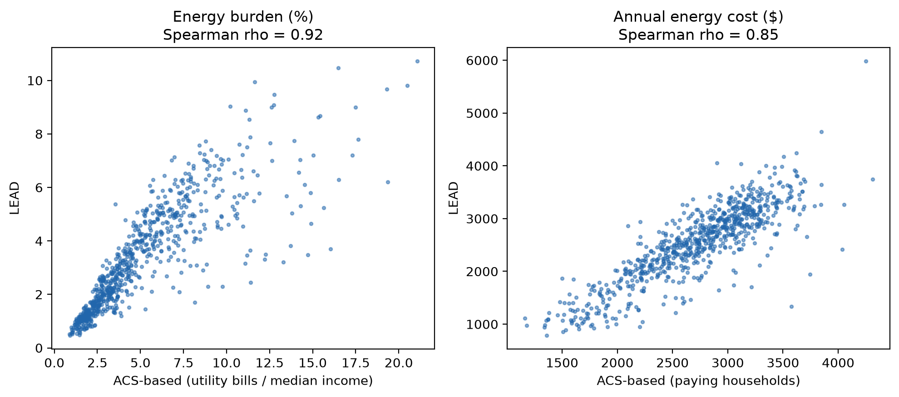

## 7. Policy analysis

- Sample: 1,054,210 households; 281,461 in groups above 6% and 164,186 above 10%.
- Priority tracts (high-burden clusters): 175 tracts, 177,342 households.
- Serving the same number of households, the rule that reaches the most severely burdened households (excluding the benchmark) is **Lowest median income**: 62,574 (38.1% of the city's), versus 58,894 for the clusters and 62,998 for the benchmark.
- A 20% cost cut for every household in the priority tracts lowers their burden from 5.43% to 4.34% and moves 16,454 households below 6% (9,934 below 10%), saving about $606 per household per year.
- The same cut limited to the 127,037 low-income households there moves 15,269 below 6% and lowers their burden from 9.54% to 7.63%.

_Counts use LEAD household-group averages, so they approximate how many households cross each line._

**Targeting rules**

| Budget | Rule | Tracts | Households | Above 10% | Share of city above 10% | Above 6% | Share of city above 6% | Overlap with clusters |
|---|---|---|---|---|---|---|---|---|
| Same number of tracts | High-burden clusters (LISA) | 175 | 177,342 | 58,894 | 35.9% | 93,905 | 33.4% | 175 |
| Same number of tracts | Lowest median income | 175 | 182,673 | 64,163 | 39.1% | 97,460 | 34.6% | 105 |
| Same number of tracts | Highest poverty rate | 175 | 187,611 | 61,037 | 37.2% | 92,490 | 32.9% | 92 |
| Same number of tracts | Highest measured burden (benchmark) | 175 | 178,520 | 63,191 | 38.5% | 100,366 | 35.7% | 131 |
| Same number of households | High-burden clusters (LISA) | 175 | 177,342 | 58,894 | 35.9% | 93,905 | 33.4% | 175 |
| Same number of households | Lowest median income | 170 | 177,591 | 62,574 | 38.1% | 94,903 | 33.7% | 103 |
| Same number of households | Highest poverty rate | 166 | 178,000 | 57,419 | 35.0% | 87,093 | 30.9% | 86 |
| Same number of households | Highest measured burden (benchmark) | 174 | 177,892 | 62,998 | 38.4% | 100,089 | 35.6% | 131 |

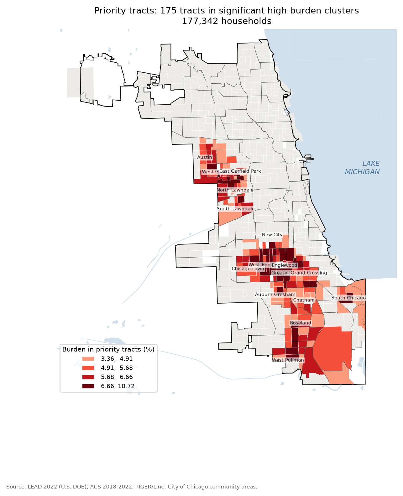

**Priority tracts by community area (top 15)**

| community_area         |   tracts |   households |
|:-----------------------|---------:|-------------:|
| Austin                 |       16 |     20883.3  |
| Chicago Lawn           |       10 |     15161.5  |
| Roseland               |       13 |     13364.7  |
| Chatham                |        8 |     12994.4  |
| Greater Grand Crossing |       12 |     11966.3  |
| South Lawndale         |       10 |     10782    |
| Auburn Gresham         |       10 |     10262.7  |
| West Englewood         |       18 |      9149.3  |
| North Lawndale         |       10 |      8933.75 |
| Englewood              |       10 |      7673.22 |
| West Pullman           |        6 |      6839.6  |
| South Chicago          |        6 |      6833.92 |
| Humboldt Park          |        3 |      6185.52 |
| West Garfield Park     |        9 |      5303.83 |
| East Garfield Park     |        9 |      4725.87 |

**Cost-cut scenarios in the priority tracts**

| Who | Cut | Households served | Burden before / after | Low-income burden before / after | Above 6% before / after | Above 10% before / after | Savings per served household |
|---|---|---|---|---|---|---|---|
| All households | 10% | 177,342 | 5.43% / 4.88% | 9.54% / 8.59% | 93,905 / 84,822 | 58,894 / 53,881 | $303 |
| All households | 20% | 177,342 | 5.43% / 4.34% | 9.54% / 7.63% | 93,905 / 77,452 | 58,894 / 48,960 | $606 |
| All households | 30% | 177,342 | 5.43% / 3.80% | 9.54% / 6.68% | 93,905 / 68,359 | 58,894 / 43,531 | $909 |
| Low-income households (<80% AMI) only | 10% | 127,037 | 5.43% / 5.06% | 9.54% / 8.59% | 93,905 / 85,512 | 58,894 / 53,962 | $286 |
| Low-income households (<80% AMI) only | 20% | 127,037 | 5.43% / 4.69% | 9.54% / 7.63% | 93,905 / 78,636 | 58,894 / 49,134 | $572 |
| Low-income households (<80% AMI) only | 30% | 127,037 | 5.43% / 4.33% | 9.54% / 6.68% | 93,905 / 69,970 | 58,894 / 43,762 | $857 |

## 8. Context: large multifamily buildings (Chicago Energy Benchmarking)

1,262 benchmarked multifamily buildings (2023). Median site energy use intensity: 71.6 kBtu/sq ft in high-burden cluster tracts (121 buildings) vs. 69.5 elsewhere (Mann-Whitney p = 0.165).

**By burden cluster**

| cluster         |   buildings |   median_site_eui |   median_gas_kbtu_per_sqft |
|:----------------|------------:|------------------:|---------------------------:|
| High-High       |         121 |              71.6 |                       48.1 |
| Low-Low         |         740 |              69.6 |                       48.9 |
| Not significant |         401 |              68.7 |                       47.5 |

**By year built**

| era           |   buildings |   median_site_eui |   median_gas_kbtu_per_sqft |
|:--------------|------------:|------------------:|---------------------------:|
| Before 1950   |         352 |              71.6 |                       55.9 |
| 1950-1979     |         342 |              79.5 |                       62.6 |
| 1980 or later |         568 |              62.8 |                       37.5 |

_Buildings of about 50,000 sq ft and up only; supporting context, not a household measure._

## Notebooks

Step-by-step notebooks with live outputs are in [`notebooks/`](../notebooks/).

