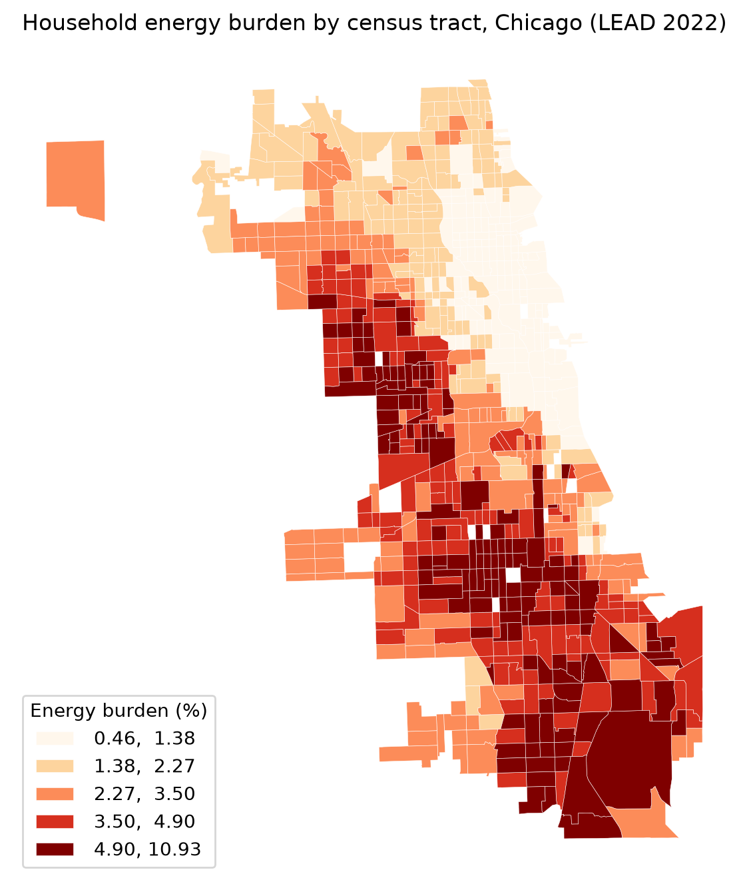
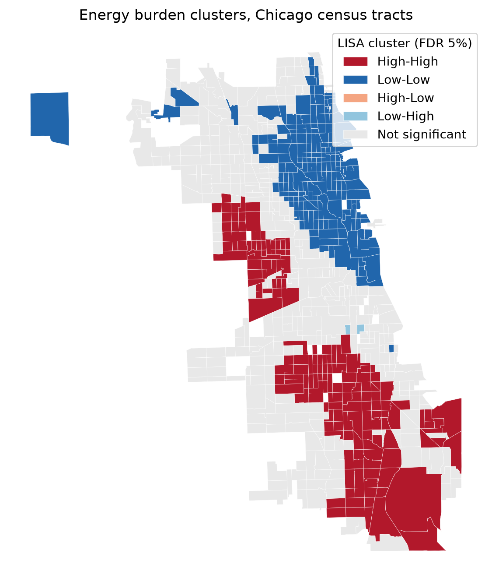
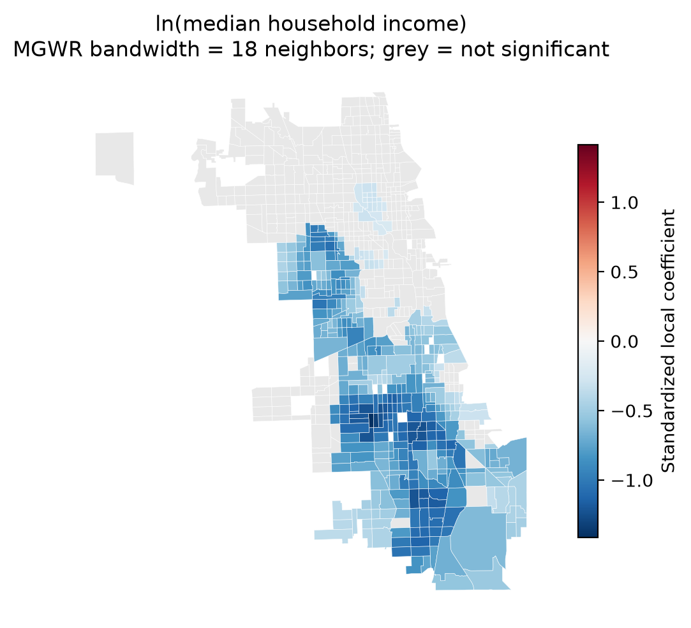
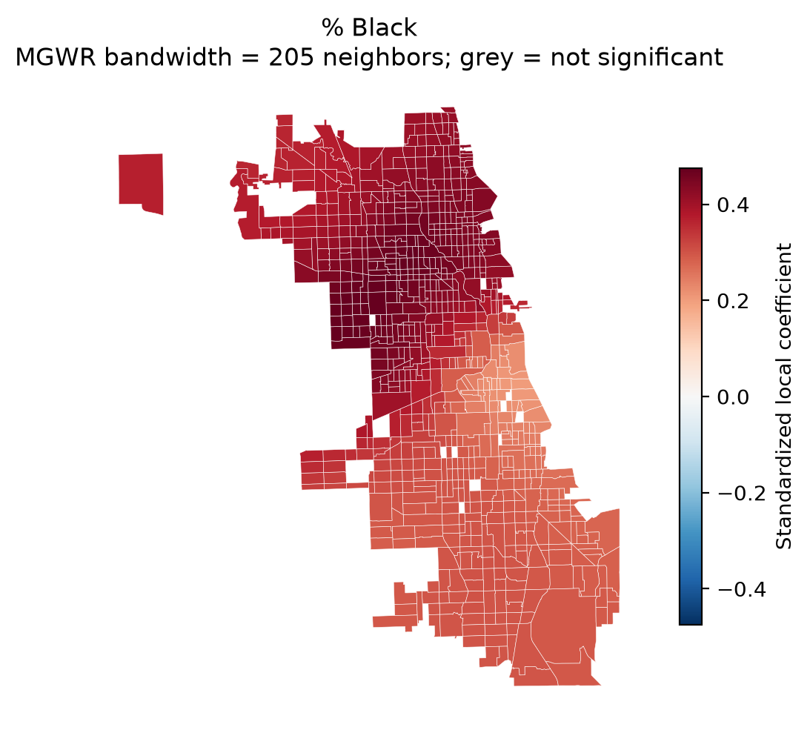
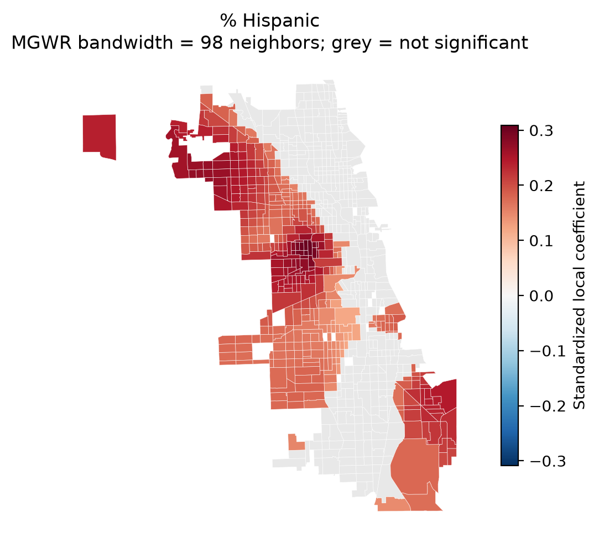
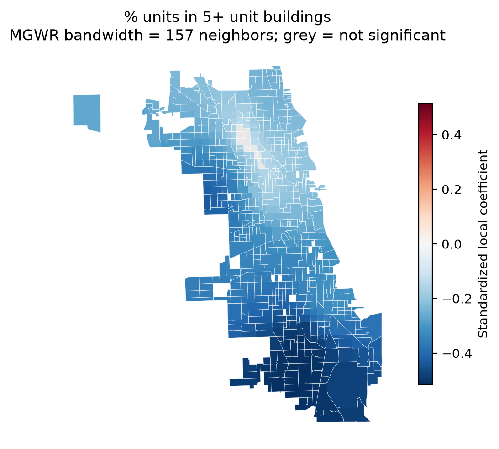
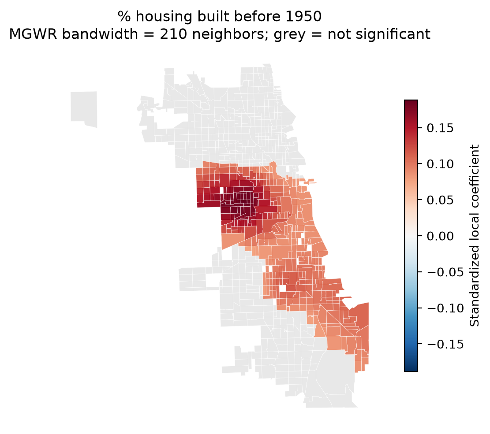
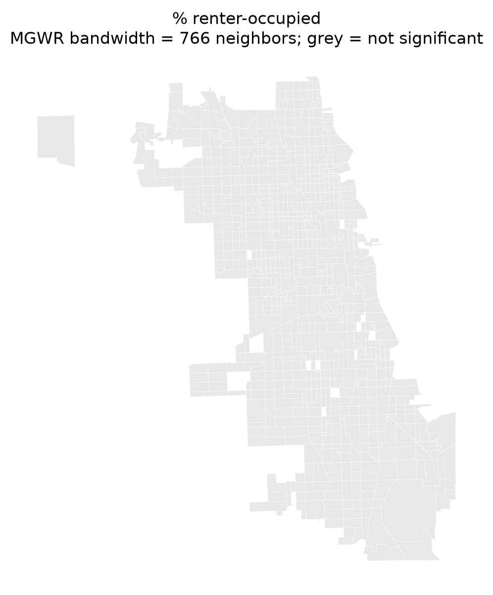
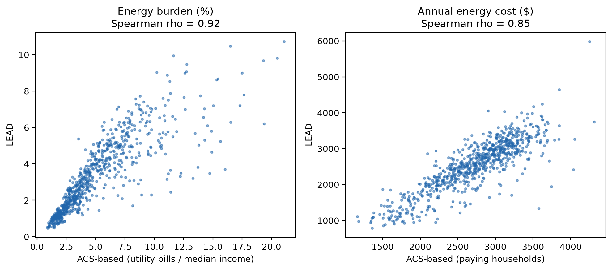

# Results: Household Energy Burden Across Chicago

_Generated 2026-11-14 19:51 UTC by the pipeline. Do not edit by hand; rerun the workflow instead._

## 1. Sample

- Tracts with >= 50% of land area in Chicago: 782
- LEAD households dropped for zero/negative cohort income: 182
- LEAD households dropped because their cohort has no valid income data: 35,787
- LEAD households kept: 1,064,942
- no LEAD record: 3  
  `17031381700, 17031980000, 17031980100`
- fewer than 100 households: 3  
  `17031381700, 17031980000, 17031980100`
- a model covariate is missing: 14  
  `17031839500, 17031080400, 17031351400, 17031681000, 17031380100, 17031381700, 17031611800, 17031980000, 17031260400, 17031570200, 17031671900, 17031980100, 17031611600, 17031550100`
- an ACS covariate has CV > 0.4 (kept; dropped in robustness): 233
- **Main analysis sample: 768 tracts**

## 2. Summary

The LEAD 2022 data cover 782 census tracts that lie mostly within Chicago; after removing tracts with too few households or missing covariates, 768 tracts and about 1,054,210 households remain. Across all of them, households spend 2.2% of income on energy. Tract burden ranges from 0.5% to 10.7% (10th to 90th percentile: 1.1% to 6.1%), and the household-weighted median tract burden is 2.4%. For households below 80% of area median income, the citywide burden is 7.0% and the median tract burden is 7.2%, compared with ACEEE's 2024 estimate of 7.2% for low-income Chicago households (2.2% for all households). About 27% of households live in income groups whose average burden is above 6%, and 16% above 10%. Burden is strongly clustered in space (global Moran's I = 0.83, p < 0.0001), with 175 tracts in significant high-burden clusters after a false discovery rate correction.

Check before using: ACEEE reports medians of household burdens, while the citywide figure above is total spending over total income. The two should be close in direction and size but are not the same statistic, so describe the comparison as a sanity check, not a match.

## 3. Where is burden concentrated? (RQ1)

| Weights | Global Moran's I | p (permutation) |
|---|---|---|
| queen | 0.826 | 0.0001 |
| knn | 0.824 | 0.0001 |

LISA clusters at 5% FDR: {'Not significant': 387, 'Low-Low': 203, 'High-High': 175, 'Low-High': 3}

| Burden | Clusters |
|---|---|
|  |  |

## 4. What explains it? (RQ2 and RQ3)

**Variance inflation factors**

|               |   VIF |
|:--------------|------:|
| ln_income     |  3.15 |
| pct_black     |  4.23 |
| pct_hispanic  |  3.01 |
| pct_pre1950   |  1.42 |
| pct_renter    |  2.49 |
| pct_multifam5 |  2.87 |

### Energy burden (%)

- Residual Moran's I = 0.363 (p = 0.0000)
- LM lag = 228.54 (p = 0.0000); LM error = 305.22 (p = 0.0000)
- Robust LM lag = 24.49 (p = 0.0000); robust LM error = 101.17 (p = 0.0000)
- Breusch-Pagan = 274.6 (p = 0.0000)
- **Decision:** Both robust LM tests reject; the larger statistic favors a spatial error model, and the spatial Durbin model is reported as a check.

### ln(average energy cost)

- Residual Moran's I = 0.277 (p = 0.0000)
- LM lag = 101.83 (p = 0.0000); LM error = 178.13 (p = 0.0000)
- Robust LM lag = 14.54 (p = 0.0001); robust LM error = 90.84 (p = 0.0000)
- Breusch-Pagan = 86.6 (p = 0.0000)
- **Decision:** Both robust LM tests reject; the larger statistic favors a spatial error model, and the spatial Durbin model is reported as a check.

**Energy burden (%)**: coefficient (standard error); * p<0.05, ** p<0.01, *** p<0.001

| label                        | OLS               | Error             | Durbin            |
|:-----------------------------|:------------------|:------------------|:------------------|
| Constant                     | 25.087*** (1.135) | 23.203*** (1.147) | 10.872*** (1.741) |
| ln(median household income)  | -1.957*** (0.092) | -1.811*** (0.093) | -1.724*** (0.096) |
| % Black                      | 0.016*** (0.002)  | 0.013*** (0.002)  | 0.006* (0.003)    |
| % Hispanic                   | 0.005** (0.002)   | 0.007** (0.002)   | 0.005 (0.003)     |
| % housing built before 1950  | 0.002 (0.002)     | 0.006** (0.002)   | 0.006*** (0.002)  |
| % renter-occupied            | 0.001 (0.002)     | -0.001 (0.002)    | 0.001 (0.002)     |
| % units in 5+ unit buildings | -0.027*** (0.002) | -0.021*** (0.002) | -0.018*** (0.002) |
| lambda (spatial error)       |                   | 0.671*** (0.035)  |                   |
| W_ln_income                  |                   |                   | 0.880*** (0.159)  |
| W_pct_black                  |                   |                   | -0.002 (0.003)    |
| W_pct_hispanic               |                   |                   | -0.005 (0.004)    |
| W_pct_pre1950                |                   |                   | -0.009*** (0.003) |
| W_pct_renter                 |                   |                   | 0.003 (0.003)     |
| W_pct_multifam5              |                   |                   | 0.005 (0.003)     |
| W_burden_pct                 |                   |                   | 0.619*** (0.038)  |

**ln(average energy cost)**: coefficient (standard error); * p<0.05, ** p<0.01, *** p<0.001

| label                        | OLS               | Error             | Durbin            |
|:-----------------------------|:------------------|:------------------|:------------------|
| Constant                     | 6.759*** (0.163)  | 6.841*** (0.172)  | 2.695*** (0.334)  |
| ln(median household income)  | 0.107*** (0.013)  | 0.100*** (0.014)  | 0.117*** (0.014)  |
| % Black                      | 0.003*** (0.000)  | 0.003*** (0.000)  | 0.001** (0.000)   |
| % Hispanic                   | 0.002*** (0.000)  | 0.002*** (0.000)  | 0.001** (0.000)   |
| % housing built before 1950  | 0.001*** (0.000)  | 0.001*** (0.000)  | 0.001*** (0.000)  |
| % renter-occupied            | -0.001** (0.000)  | -0.002*** (0.000) | -0.002*** (0.000) |
| % units in 5+ unit buildings | -0.009*** (0.000) | -0.008*** (0.000) | -0.007*** (0.000) |
| lambda (spatial error)       |                   | 0.638*** (0.037)  |                   |
| W_ln_income                  |                   |                   | -0.047* (0.022)   |
| W_pct_black                  |                   |                   | 0.000 (0.001)     |
| W_pct_hispanic               |                   |                   | -0.001 (0.001)    |
| W_pct_pre1950                |                   |                   | -0.001*** (0.000) |
| W_pct_renter                 |                   |                   | 0.002*** (0.001)  |
| W_pct_multifam5              |                   |                   | 0.002*** (0.001)  |
| W_ln_avg_energy_cost         |                   |                   | 0.564*** (0.041)  |

**Model comparison**

| outcome            | model   |      aic |    logll |   moran_resid_I |
|:-------------------|:--------|---------:|---------:|----------------:|
| burden_pct         | OLS     |  1855.02 | -920.512 |           0.363 |
| burden_pct         | error   |  1631.77 | -808.886 |          -0.036 |
| burden_pct         | durbin  |  1611.81 | -791.906 |          -0.03  |
| ln_avg_energy_cost | OLS     | -1122.3  |  568.15  |           0.277 |
| ln_avg_energy_cost | error   | -1276.24 |  645.12  |          -0.019 |
| ln_avg_energy_cost | durbin  | -1321.34 |  674.67  |          -0.009 |

## 5. Does it differ across the city? (RQ4)

MGWR adjusted R² = 0.930; AICc = 338.8; max local condition number = 9.3

| Variable | Bandwidth (neighbors) |
|---|---|
| CONSTANT | 433 |
| ln_income | 18 |
| pct_black | 205 |
| pct_hispanic | 98 |
| pct_pre1950 | 210 |
| pct_renter | 760 |
| pct_multifam5 | 157 |

|   |   |   |
|---|---|---|
|  |  |  |

|   |   |   |
|---|---|---|
|  |  |  |

## 6. Robustness checks

Each column changes one thing relative to the main spatial error model. Coefficient (standard error); * p<0.05, ** p<0.01, *** p<0.001.

- Energy burden (%): 6 of 6 coefficients keep the same sign and significance in every specification.
- ln(average energy cost): 6 of 6 coefficients keep the same sign and significance in every specification.

**Energy burden (%)**

|                              | Main (queen, ACS 2018-22)   | A. KNN-6 weights    | B. Reliable ACS only (n=541)   | C. ACS 2020-24 (n=755)   | stable across specs   |
|:-----------------------------|:----------------------------|:--------------------|:-------------------------------|:-------------------------|:----------------------|
| ln(median household income)  | -1.8113*** (0.0928)         | -1.8246*** (0.0943) | -1.7842*** (0.1106)            | -1.5029*** (0.1000)      | yes                   |
| % Black                      | 0.0135*** (0.0021)          | 0.0142*** (0.0020)  | 0.0145*** (0.0022)             | 0.0195*** (0.0022)       | yes                   |
| % Hispanic                   | 0.0071** (0.0024)           | 0.0072** (0.0024)   | 0.0067* (0.0028)               | 0.0126*** (0.0025)       | yes                   |
| % housing built before 1950  | 0.0058** (0.0018)           | 0.0061*** (0.0018)  | 0.0044* (0.0022)               | 0.0040* (0.0020)         | yes                   |
| % renter-occupied            | -0.0013 (0.0022)            | -0.0009 (0.0022)    | -0.0013 (0.0028)               | -0.0022 (0.0023)         | yes                   |
| % units in 5+ unit buildings | -0.0212*** (0.0020)         | -0.0212*** (0.0019) | -0.0228*** (0.0022)            | -0.0201*** (0.0021)      | yes                   |

**ln(average energy cost)**

|                              | Main (queen, ACS 2018-22)   | A. KNN-6 weights    | B. Reliable ACS only (n=541)   | C. ACS 2020-24 (n=755)   | stable across specs   |
|:-----------------------------|:----------------------------|:--------------------|:-------------------------------|:-------------------------|:----------------------|
| ln(median household income)  | 0.0996*** (0.0140)          | 0.0956*** (0.0140)  | 0.0904*** (0.0174)             | 0.1036*** (0.0140)       | yes                   |
| % Black                      | 0.0028*** (0.0003)          | 0.0028*** (0.0003)  | 0.0028*** (0.0003)             | 0.0028*** (0.0003)       | yes                   |
| % Hispanic                   | 0.0019*** (0.0004)          | 0.0019*** (0.0004)  | 0.0015*** (0.0004)             | 0.0019*** (0.0003)       | yes                   |
| % housing built before 1950  | 0.0013*** (0.0003)          | 0.0012*** (0.0003)  | 0.0016*** (0.0004)             | 0.0011*** (0.0003)       | yes                   |
| % renter-occupied            | -0.0020*** (0.0003)         | -0.0020*** (0.0003) | -0.0022*** (0.0004)            | -0.0012*** (0.0003)      | yes                   |
| % units in 5+ unit buildings | -0.0078*** (0.0003)         | -0.0077*** (0.0003) | -0.0083*** (0.0003)            | -0.0081*** (0.0003)      | yes                   |

**Share of households above the 6% and 10% lines** (fractional logit, average marginal effects; shares are lower bounds, see method notes)

| label                        | Share above 6%      | Share above 10%     |
|:-----------------------------|:--------------------|:--------------------|
| % Black                      | 0.0016*** (0.0001)  | 0.0011*** (0.0001)  |
| % Hispanic                   | 0.0014*** (0.0002)  | 0.0005*** (0.0002)  |
| % housing built before 1950  | 0.0001 (0.0001)     | 0.0002 (0.0001)     |
| % renter-occupied            | -0.0003 (0.0002)    | 0.0005* (0.0002)    |
| % units in 5+ unit buildings | -0.0020*** (0.0002) | -0.0014*** (0.0002) |
| ln(median household income)  | -0.2129*** (0.0104) | -0.1351*** (0.0092) |

**Independent ACS burden check** (LEAD vs. ACS utility-cost tables)

| Measure | Pearson r | Spearman rho | Top-20% overlap | n |
|---|---|---|---|---|
| burden | 0.85 | 0.92 | 70% | 768 |
| annual cost | 0.86 | 0.85 | 64% | 768 |

_ACS costs cover only households that pay electricity/gas bills directly and use bin midpoints (top bin x1.25); the denominator is median household income. Expect strong rank agreement, not equal levels._

